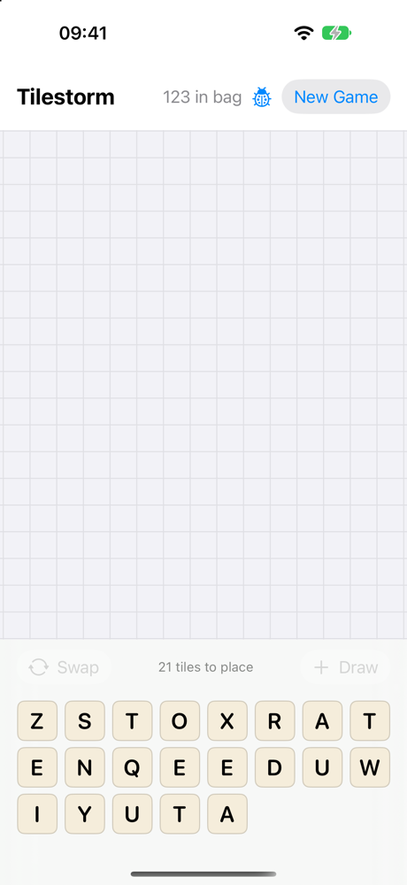
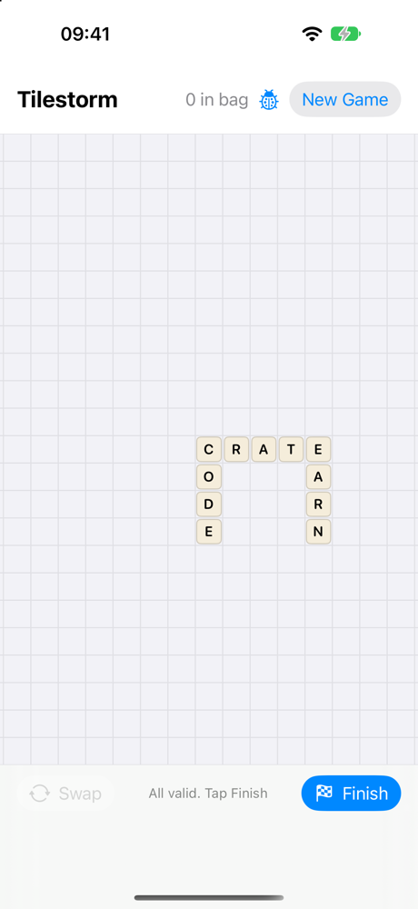
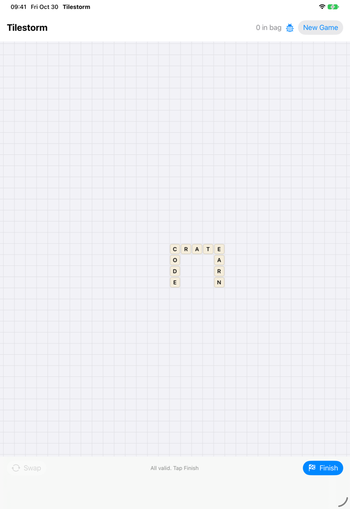

# Tilestorm

A minimal native iPhone and iPad word-tile game. Build your own crossword from a hand of letter tiles, draw more as you go, and use every tile in the bag to finish.

  
  
  

  

## How to play

- **Place tiles** by dragging them from the rack, or tap a rack tile and then a cell.
- **Move tiles** by dragging, or tap one to select it and tap where it should go. Dropping on another tile swaps them.
- **Return a tile** by double-tapping it, or dragging it back to the rack.
- **Draw** a tile once every tile is on the board in real, connected words.
- **Swap** a selected tile for three from the bag.
- **Finish** when the bag is empty and your grid is valid.

## Project layout

- `Tilestorm.xcodeproj`: the SwiftUI app (iOS 18+, iPhone and iPad)
- `Packages/TileEngine`: the UI-independent rules engine. Run its tests with `swift test`.

Words are checked against the [ENABLE word list](https://github.com/dolph/dictionary) (public domain).

Debug builds include a Scenarios menu (the ladybug) for jumping straight to set-up game states. You can also launch into one with `-scenario readyToFinish`, `oneTileLeft`, or `invalidGrid`.
